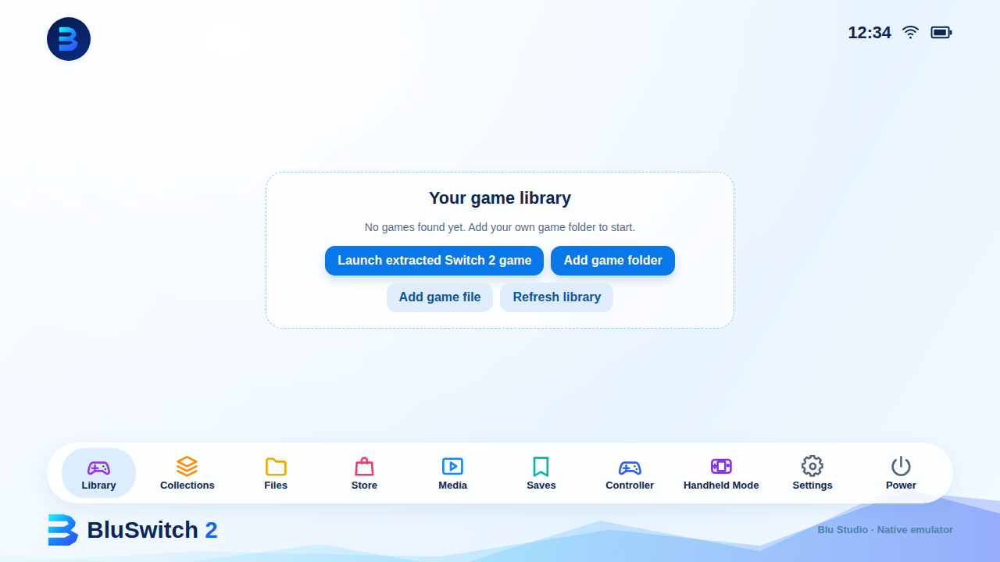
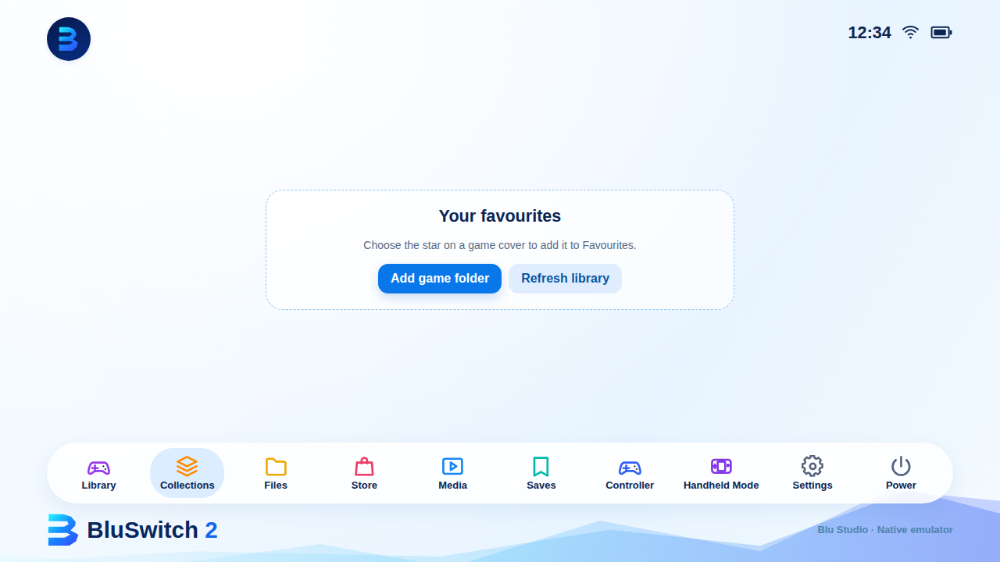

# BluSwitch 2

BluSwitch 2 is an experimental, standalone ARM64 Android Nintendo Switch 2 emulator build from Blu Studio. It combines our original blue handheld-style interface with the GPL-licensed Eden SX2A / NX2 emulator core. The native engine runs inside the same app, not through a separately installed Eden emulator.

## Our Switch 2 emulator so far

These images show the current BluSwitch 2 user interface. They are UI previews with an empty game library, not captures of Switch 2 gameplay.

### Game library



### Favourites



## Current status

- BluSwitch 2's blue home screen, logo, Library and Favourites are integrated into the native Android app.
- Files has an in-app folder picker, and Settings has an import option for your own `prod.keys`.
- Menu screens stay in the BluSwitch 2 interface. Controller configuration, media management and save browsing are still in development.
- [GitHub Actions](https://github.com/maccabluu/BluSwitch2/actions) builds the ARM64 Android APK. Download only from successful build artifacts.
- Emulator compatibility and performance on an AYN Thor are not verified. The underlying Switch 2 engine is experimental.

## Source and build

The [BluSwitch 2 Native Android workflow](https://github.com/maccabluu/BluSwitch2/actions/workflows/bluswitch2-native-android.yml) downloads tagged upstream source from [moceure/eden-nx2-android](https://git.eden-emu.dev/moceure/eden-nx2-android), applies BluSwitch's app ID, branding, integrated interface and Android actions, then builds the APK.

The [UI screenshots workflow](https://github.com/maccabluu/BluSwitch2/actions/workflows/bluswitch-ui-screenshots.yml) generates the two interface previews above directly from our committed HTML and CSS.


## Playing games in the BluSwitch 2 test build

BluSwitch 2 uses the original native Eden NX2 Android core in the same APK. **This fork is experimental and is not verified to run games on an AYN Thor Pro yet.**

For Switch 2, the core currently launches **loose, extracted game folders**, not Switch 2 NSP/XCI containers. A supported folder has this structure:

```text
Game Name/
  exefs/
    main
    main.npdm
    rtld
    sdk
  romfs/
    ...
```

From the BluSwitch home screen, open **Files → Launch extracted Switch 2 game**, grant **All files access** if prompted, and choose the **Game Name** folder. The native launcher searches for `exefs/main` and passes the real path to the emulator. The engine's **Switch 2 readiness check** is under BluSwitch Settings and checks memory, storage permission, drivers and other requirements. The first boot can be black for several minutes on supported devices. A persistent black screen does not establish that the game is compatible.

Original Switch NSP/XCI files may be handled by the core's legacy loaders, subject to valid user-owned files and the required keys. **Switch 2 NSP/XCI playback is not implemented.** Merely recognising a PFS0/HEAD header does not make those files playable.

The upstream experimental build was tested on a 16 GB RAM Snapdragon/Adreno phone. The AYN Thor Pro has 12 GB RAM and Adreno 740, so Switch 2 performance and stability are not assured.

To report a failed game boot, use **BluSwitch Settings → Share debug logs** immediately after the attempt and share the report with the game name and file layout. Debug reports contain device and log information, so review them before sharing. No games, keys or firmware are included.

## Games, keys and firmware

No games, encryption keys or console firmware are included. Import only files dumped from hardware you own. Some encrypted games require `prod.keys`; loose extracted Switch 2 ExeFS games do not require keys according to the upstream project's documentation. Switch 2 titles in NSP/XCI containers are not supported by the upstream Switch 2 loader.

## Licence and credits

The modified emulator and Android application follow the upstream project's GPL-3.0-or-later licence and applicable third-party licences. Upstream authors retain their rights and credits. This is an unofficial app, not affiliated with Nintendo or endorsed by Eden.
